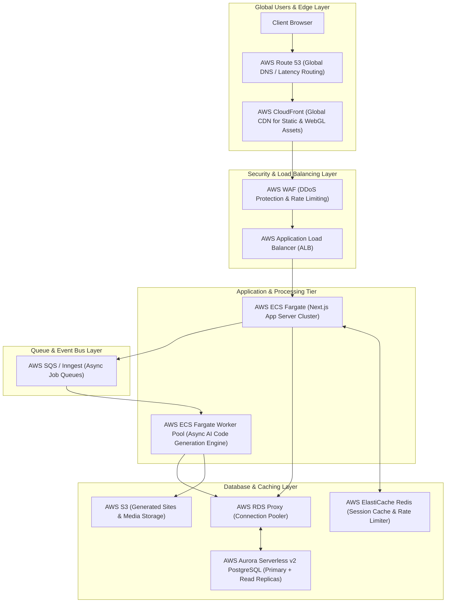

# Vibel: Enterprise AWS Scalability & Architecture Blueprint

This document outlines the complete architectural roadmap to scale **Vibel: The Editorial AI Builder** to handle **100,000+ concurrent users** and millions of real-time AI code generations using **Amazon Web Services (AWS)**.

---

## 1. System Architecture Diagram

---

## 2. Layer-by-Layer AWS Component Breakdown

### A. Edge & Ingress Layer (Global Routing & Security)
- **AWS Route 53**: 
  - Manages global DNS with **Latency-Based Routing** and automated health checks to route traffic to the nearest healthy AWS region.
- **AWS CloudFront (CDN)**:
  - Serves static Next.js assets (`/_next/static`), WebGL textures, Three.js models, and generated web app previews at sub-30ms latency worldwide.
- **AWS WAF (Web Application Firewall)**:
  - Protects against OWASP Top 10 vulnerabilities, SQL injection, and automated bot attacks.
  - Implements IP-based rate limiting at the edge to protect tRPC endpoints from DDoS attacks.
- **AWS Application Load Balancer (ALB)**:
  - Handles SSL/TLS termination using **AWS Certificate Manager (ACM)**.
  - Distributes traffic across dynamic target groups of containerized Next.js tasks based on CPU and memory utilization.

---

### B. Application Compute Tier (Next.js & tRPC)
- **AWS ECS (Fargate) for Next.js**:
  - Containerizes the Next.js application into Docker containers running on Serverless ECS Fargate.
  - Configured with **Target Tracking Auto Scaling Policies** (scales out when CPU > 60% or RAM > 70%).
- **AWS RDS Proxy (Database Connection Pooling)**:
  - Sits between ECS Fargate instances and PostgreSQL to handle thousands of concurrent serverless database connections without exhausting database pool limits.

---

### C. Asynchronous AI Code Generation Engine
AI code generation (LLM prompt enhancement, code synthesis, sandbox execution) is I/O-intensive and long-running. It must be decoupled from the main web HTTP request-response lifecycle.

- **AWS SQS (Simple Queue Service) + Inngest**:
  - Web requests place code generation jobs onto SQS FIFO queues.
- **AWS ECS Fargate Worker Pool / E2B Sandbox Pool**:
  - Dedicated background worker containers poll SQS queues and execute LLM synthesis, code linting, and sandbox compilation.
  - Real-time progress is streamed back to the browser via **WebSockets / Server-Sent Events (SSE)**.

---

### D. Data Storage & Caching Layer
- **AWS Aurora Serverless v2 PostgreSQL**:
  - Scales capacity up and down instantly in fine-grained increments (ACUs) based on workload.
  - Configured with multi-region **Read Replicas** for ultra-fast user query response times.
- **AWS ElastiCache for Redis**:
  - Stores volatile rate-limit state (`RateLimiterPrisma` fallback), active WebGL configuration sessions, and tRPC query response caches.
- **AWS S3 (Simple Storage Service)**:
  - Stores compiled project bundles, user upload assets, and static preview sites.

---

## 3. High-Impact Performance Optimizations

### 1. WebGL & Three.js Background Rendering Optimization
To ensure `CinematicBackground` maintains 60 FPS on low-spec client devices:
- **Device Pixel Ratio (DPR) Cap**: Cap WebGL DPR to `Math.min(window.devicePixelRatio, 1.5)` to prevent 4K/Retina rendering overhead.
- **OffscreenCanvas & Web Workers**: Offload heavy Three.js matrix calculations to a Web Worker thread to prevent blocking main UI interaction.
- **Intersection Observer Pause**: Automatically pause `requestAnimationFrame` loops when the background canvas is out of view or tab is hidden.

### 2. Database & Connection Management
- Use **Prisma Accelerate** or **AWS RDS Proxy** to eliminate cold-start connection penalties.
- Wrap read-only queries with Redis caching (`getMany` projects cached for 10s with stale-while-revalidate).

### 3. Next.js Bundle & Dynamic Imports
- Dynamically import heavy 3D rendering modules (`three`, WebGL canvases) using `next/dynamic` with `{ ssr: false }`.

---

## 4. Scaling Deployment Checklist

| Component | AWS Resource | Target Scaling Metric | Action |
| :--- | :--- | :--- | :--- |
| **Frontend CDN** | CloudFront | Hit Ratio > 90% | Edge caching for static & showcase assets |
| **HTTP Load Balancer** | ALB + WAF | Request Count / Min | Rate limit > 100 req/min per IP |
| **Application Tasks** | ECS Fargate | CPU > 60%, RAM > 70% | Auto-scale container task count (2 to 50) |
| **Async AI Workers** | SQS + ECS Workers | Queue Depth > 100 | Scale worker task count dynamically |
| **Database** | Aurora Serverless v2 | ACU Utilization | Auto-scale 0.5 to 128 ACUs |
| **Session Cache** | ElastiCache Redis | Memory Usage > 75% | Scale node size or cluster sharding |
