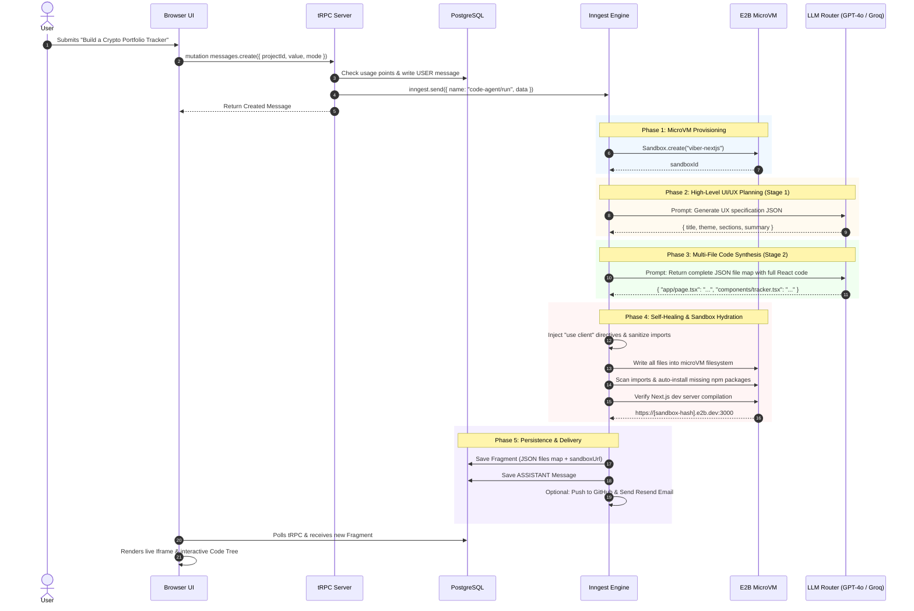
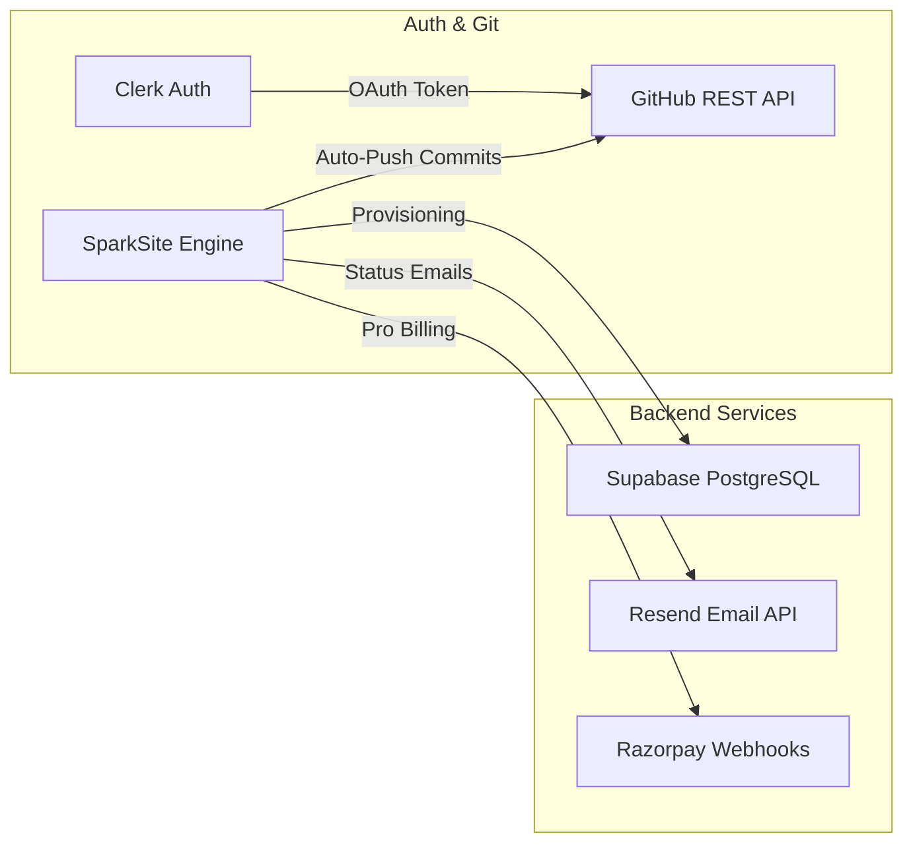
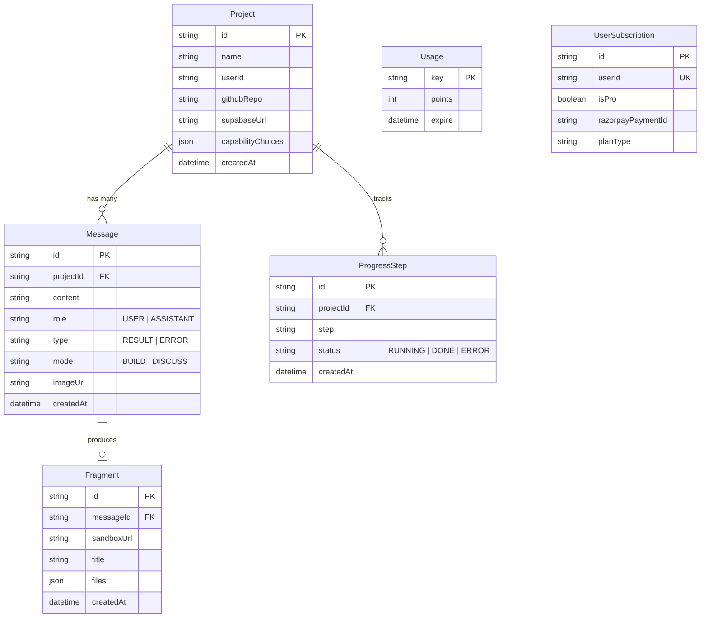

# ⚡ SparkSite (Vibel): Building an Autonomous AI Full-Stack Web Application Engine

> **A Comprehensive Architectural Deep-Dive, System Design Blueprint, and Technical Reference**  
> *Author:* Vaibhav  
> *Repository:* [SparkSite / Vibel](https://github.com/your-username/vibel)

---

## 📑 Table of Contents
1. [Executive Summary & Vision](#1-executive-summary--vision)
2. [Why This Tech Stack? (Design Decisions & Trade-offs)](#2-why-this-tech-stack-design-decisions--trade-offs)
3. [System Architecture & Data Flow](#3-system-architecture--data-flow)
4. [The Generation Pipeline (From Prompt to Live Preview)](#4-the-generation-pipeline-from-prompt-to-live-preview)
5. [Cloud MicroVM Sandboxing with E2B](#5-cloud-microvm-sandboxing-with-e2b)
6. [The Virtual Filesystem (VFS) & Code Explorer](#6-the-virtual-filesystem-vfs--code-explorer)
7. [External Integrations & Ecosystem](#7-external-integrations--ecosystem)
8. [Database Schema & State Management](#8-database-schema--state-management)
9. [Self-Healing & Error Recovery Mechanisms](#9-self-healing--error-recovery-mechanisms)
10. [Key Takeaways & Lessons Learned](#10-key-takeaways--lessons-learned)

---

## 1. Executive Summary & Vision

Modern AI code assistants usually generate disconnected snippets or simple single-file scripts in chat windows. **SparkSite (Vibel)** was built to solve a fundamentally harder problem:

> **How can a user describe an entire SaaS product, dashboard, or web tool in plain English (or provide an image mockup) and receive a fully functional, multi-file, styled Next.js 15 application running in a live cloud sandbox in under 45 seconds?**

SparkSite achieves this by uniting **durable background execution**, **deterministic multi-file AI synthesis**, **cloud microVMs**, and **real-time preview streaming**.

---

## 2. Why This Tech Stack? (Design Decisions & Trade-offs)

When building an autonomous AI app builder, standard web architectures quickly break down. Below is the technical rationale behind every layer of the stack:

```
┌─────────────────────────────────────────────────────────────────────────────┐
│                             SPARKSITE CORE STACK                            │
├───────────────────────┬────────────────────────────┬────────────────────────┤
│ Frontend & Framework  │ Next.js 15 (App Router)    │ React 19, Turbopack    │
│ Styling & UI Library  │ Tailwind CSS v4            │ Lucide Icons, Radix UI │
│ Communication Layer   │ tRPC v11                   │ TanStack Query v5      │
│ Background Workflows  │ Inngest                    │ Step-based execution   │
│ Code Execution        │ E2B Code Interpreter       │ Linux MicroVMs         │
│ Database & ORM        │ PostgreSQL                 │ Prisma ORM             │
│ Authentication & Auth │ Clerk                      │ GitHub OAuth Tokens    │
│ Multi-Model AI Router │ OpenAI (GPT-4o)            │ Groq / Gemini Fallback │
└───────────────────────┴────────────────────────────┴────────────────────────┘
```

### 1. Next.js 15 (App Router) + React 19
- **Symmetry with the Generated Output:** SparkSite generates Next.js 15 applications. Running the host platform on Next.js 15 ensures that shared components, utilities, and typing conventions (`use client`, Turbopack configurations, layout conventions) remain 100% consistent across host and generated applications.
- **Fast Turbopack Tooling:** Provides sub-second hot reloading during local development.

### 2. tRPC v11 + TanStack Query
- **End-to-End Compile-Time Safety:** Eliminates REST endpoint boilerplate and manual schema synchronization. When backend procedures change, frontend hooks throw TypeScript compile errors immediately.
- **Reactive Polling & Optimistic UI:** TanStack Query handles automatic polling for generation progress, cached message trees, and instant user message rendering.

### 3. Inngest (Durable Async Workflows)
- **Overcoming Serverless Execution Limits:** AI generation, sandbox provisioning, package installations, and compiler warmup require 30 to 60 seconds. Standard serverless endpoints (e.g. Vercel, AWS Lambda) timeout at 10–15 seconds.
- **Resilient Step-by-Step Checkpointing:** Inngest allows multi-step execution (`step.run`). If a downstream step (e.g., GitHub auto-sync) encounters an issue, previous expensive steps (AI generation, sandbox setup) do not need to be recomputed.

### 4. E2B Code Interpreter (MicroVM Cloud Sandboxes)
- **Secure Sandboxing:** Executing untrusted AI-generated code directly on server infrastructure is a major security vulnerability. E2B spins up isolated Linux microVMs in sub-seconds.
- **Live Port Forwarding:** E2B exposes port `3000` via `sandbox.getHost(3000)`, delivering a secure, public HTTPS URL for instant iframe embedding.

### 5. Multi-Model AI Routing (GPT-4o + Groq / Gemini Fallback)
- **High-Fidelity Code Synthesis:** GPT-4o delivers nuanced multi-file architectural coherence and strict adherence to modern React 19 standards.
- **Outage & Rate-Limit Resilience:** If OpenAI experiences rate limiting or outages, the pipeline automatically falls back to Groq (Llama-3.3-70B) or Google Gemini Flash without failing the user's generation.

### 6. Clerk Authentication & GitHub OAuth Token Harvesting
- **Integrated Developer Identity:** Clerk manages secure sign-in/sign-up and stores users' GitHub OAuth tokens. SparkSite retrieves these tokens via `clerkClient().users.getUserOauthAccessToken()` to directly create and push repositories to the user's GitHub account with one click.

---

## 3. System Architecture & Data Flow

```mermaid
flowchart TD
    subgraph Client["🖥️ Frontend (Next.js 15 + React 19)"]
        UI[Chat Interface & Prompt Input]
        Viewer[Split View: Code Explorer + Live Iframe Preview]
        Progress[Real-Time Progress Step Indicator]
    end

    subgraph API["⚡ API & Gateway (tRPC v11)"]
        TRPCRouter[appRouter.messages.create]
        QuotaCheck[RateLimiterPrisma / Usage Tracker]
    end

    subgraph Queue["⚙️ Workflow Engine (Inngest)"]
        InngestEvent[Event: 'code-agent/run']
        Step1[Step 1: Provision E2B Sandbox]
        Step2[Step 2: Hydrate Existing VFS Files]
        Step3[Step 3: Multi-Agent AI Generation]
        Step4[Step 4: Self-Healing & Compile Check]
        Step5[Step 5: Persist Fragment to DB]
        Step6[Step 6: Sync to GitHub & Send Email]
    end

    subgraph CloudSandbox["☁️ E2B MicroVM Sandbox"]
        VM[Linux MicroVM: viber-nextjs]
        VFS[Virtual File System: app/, components/, lib/]
        NextServer[Next.js Dev Server on Port 3000]
        ProxyURL["HTTPS Sandbox URL (sandbox.getHost(3000))"]
    end

    subgraph Database["🗄️ PostgreSQL (Prisma ORM)"]
        DB_Proj[(Projects)]
        DB_Msg[(Messages)]
        DB_Frag[(Fragments - VFS Snapshots)]
        DB_Steps[(ProgressSteps)]
    end

    UI -->|1. Submit Prompt & Image| TRPCRouter
    TRPCRouter -->|2. Check Points & Deduct Quota| QuotaCheck
    TRPCRouter -->|3. Persist User Message| DB_Msg
    TRPCRouter -->|4. Trigger Inngest Event| InngestEvent
    TRPCRouter -->>|5. Instant Response| UI

    InngestEvent --> Step1
    Step1 -->|Spin up MicroVM| VM
    Step1 --> Step2
    Step2 -->|Read Prior Code Snapshot| DB_Frag
    Step2 --> Step3
    Step3 -->|Generate Spec & Multi-File Code| CloudSandbox
    Step3 --> Step4
    Step4 -->|Write Sanitized Files & Install Missing npm| VFS
    VFS --> NextServer
    NextServer --> ProxyURL
    Step4 --> Step5
    Step5 -->|Save Fragment JSON & Assistant Message| DB_Frag
    Step5 --> Step6

    Progress -.->|Poll Progress Steps| DB_Steps
    Viewer -->|Embed Live Preview| ProxyURL
    Viewer -->|Read Code Files| DB_Frag
```

---

## 4. The Generation Pipeline (From Prompt to Live Preview)

When a user clicks **Generate**, the system executes a 5-phase deterministic pipeline:



---

## 5. Cloud MicroVM Sandboxing with E2B

### The Template: `viber-nextjs`
SparkSite uses a pre-built custom E2B template configured with:
- Next.js 15 (App Router)
- Tailwind CSS & PostCSS
- Pre-installed utility suites: `lucide-react`, `framer-motion`, `recharts`, `date-fns`, `clsx`, `tailwind-merge`
- Pre-injected Shadcn UI components in `components/ui/*`

### Sandbox Lifecycle
1. **Creation:** `Sandbox.create("viber-nextjs", { timeoutMs: 60 * 60 * 1000 })` boots an isolated Linux container.
2. **Hydration:** Prior code versions and new AI-generated files are written concurrently via `sandbox.files.write(path, content)`.
3. **Dynamic Package Installation:** The engine scans AST imports for uninstalled npm packages and runs `npm install <package>` in the sandbox on the fly.
4. **Dev Server Verification:** The engine ensures `next dev --hostname 0.0.0.0 --port 3000` is active and responsive.
5. **URL Resolution:** `sandbox.getHost(3000)` produces the live HTTPS URL for the client iframe.

---

## 6. The Virtual Filesystem (VFS) & Code Explorer

Instead of maintaining brittle file pointers on disk, SparkSite models projects as an **immutable series of Virtual Filesystem (VFS) snapshots** stored in PostgreSQL:

```typescript
// Fragment Data Model in Prisma
model Fragment {
  id         String   @id @default(uuid())
  messageId  String   @unique
  message    Message  @relation(fields: [messageId], references: [id], onDelete: Cascade)
  sandboxUrl String
  title      String
  files      Json     // Key-value map: { [filepath: string]: string }
  createdAt  DateTime @default(now())
  updatedAt  DateTime @updatedAt
}
```

### Benefits of the VFS Snapshot Model:
1. **Version Time Travel:** Every prompt generates a new `Message` and associated `Fragment`. Users can click on any previous message in chat history to instantly preview that exact iteration of the code.
2. **Instant ZIP Export:** Using `JSZip`, the client converts the `files` JSON map directly into a downloadable `.zip` file with zero server CPU overhead.
3. **Interactive Code Explorer:** The frontend parses the flat path keys into a hierarchical tree structure with PrismJS syntax highlighting.

---

## 7. External Integrations & Ecosystem



### 1. 🐙 One-Click GitHub Export
SparkSite connects directly with the user's GitHub account. When enabled:
- The system fetches the user's GitHub OAuth token from Clerk.
- It creates a new repository (or opens an existing one) using the GitHub API.
- It pushes the entire virtual filesystem as a single Git commit with an automated commit message.

### 2. ⚡ Supabase Database Connection
Users can connect their Supabase project credentials (`supabaseUrl` and `supabaseAnonKey`). The AI system prompt automatically injects Supabase client initializers into the generated Next.js code.

### 3. 💳 Razorpay Monetization & Rate Limiting
- **Free Tier:** 5 generation points per 30-minute rolling window managed via `RateLimiterPrisma`.
- **Pro Tier:** 100 points per window, activated automatically via Razorpay checkout webhooks verifying payment signatures (`x-razorpay-signature`).

---

## 8. Database Schema & State Management



---

## 9. Self-Healing & Error Recovery Mechanisms

AI code generation can fail due to syntax errors, missing directives, or missing packages. SparkSite implements a **three-tier self-healing strategy**:

1. **Deterministic Directive Injection:**
   - Any React component using hooks (`useState`, `useEffect`, `useRef`) or browser event handlers (`onClick`, `onChange`) is automatically inspected and injected with `"use client";` at line 1 before writing to the sandbox.
2. **Dynamic Dependency Discovery:**
   - The engine scans generated files for npm imports (e.g. `import { motion } from "framer-motion"` or `import { Canvas } from "@react-three/fiber"`).
   - If an import is not in `package.json`, it automatically executes `npm install <pkg>` inside the E2B sandbox.
3. **Structured JSON Fallback Strategy:**
   - If the primary model (GPT-4o) fails to return valid JSON, the parser repairs truncated brackets.
   - If parsing still fails, the request automatically reroutes to the secondary model (Groq / Gemini) with strict JSON output mode.

---

## 10. Key Takeaways & Lessons Learned

1. **Durable Queues are Essential for AI Workflows:** Separating HTTP request handling from agent execution via Inngest is the single most important pattern for eliminating 504 timeouts and handling long-running sandbox tasks.
2. **MicroVMs Beat WebContainers for Next.js:** In-browser WebContainers are resource-heavy and struggle with native binaries or full Next.js server components. Cloud microVMs (E2B) provide real Linux compatibility and zero client-device performance penalties.
3. **VFS Snapshots Make History Trivially Simple:** Storing files as a single JSON object per message makes undo/redo, version branching, and ZIP exports simple and deterministic.

---

*SparkSite ⚡ — Built by [Vaibhav](https://www.linkedin.com/in/vaibhavkumarprince/)*
